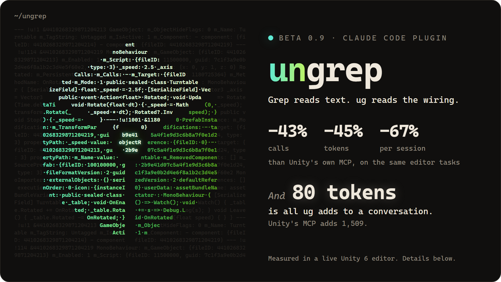
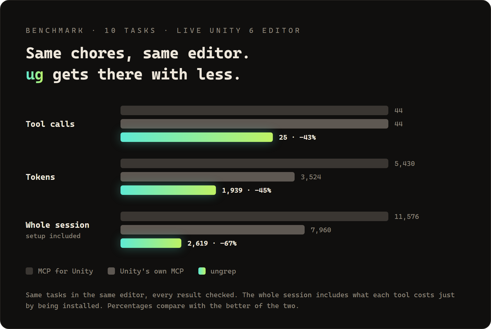
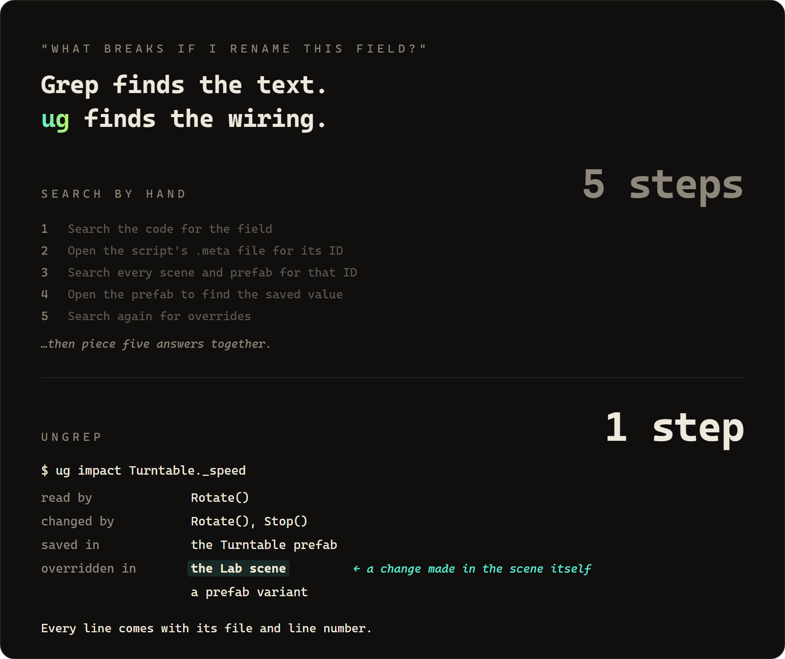
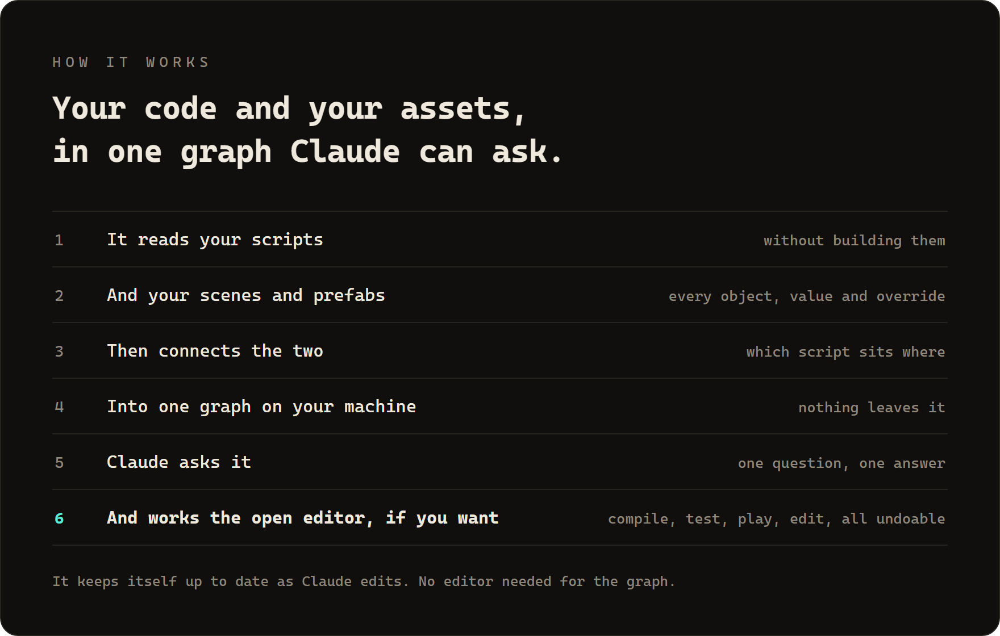

<p align="center">
  <picture>
    <source media="(prefers-color-scheme: dark)" srcset="assets/logo-dark.svg">
    
  </picture>
</p>

<h1 align="center">ungrep</h1>

<p align="center">
  <em>Grep reads text. <code>ug</code> reads the wiring.</em>
</p>

<p align="center">
  
  
  
  
</p>

<p align="center">
  
</p>

<p align="center">
  <strong>ungrep keeps a map of your Unity project outside Claude.</strong><br>
  Your code, scenes and prefabs, and how they connect. Claude asks the map instead of digging through files.
</p>

---

## Numbers

<p align="center">
  
</p>

On 19 everyday questions about a project, Claude needed 71 searches and file reads on its own, and 31 with ungrep. Every answer right both ways. [How we measured](https://github.com/UmarAbdullaev/ungrep/tree/main/bench).

## Before / after

<p align="center">
  
</p>

## How it works

<p align="center">
  
</p>

It also looks out for you without being asked: it warns Claude before a rename breaks a prefab, and catches compile errors before Claude says it's done.

## Install

**1. The plugin.** In Claude Code, run these one at a time:

```
/plugin marketplace add UmarAbdullaev/ungrep
```
```
/plugin install ungrep@ungrep
```

You need the [.NET 8 runtime](https://dotnet.microsoft.com/download/dotnet/8.0) or newer and Unity 2022.3 or newer. Start Claude Code in your Unity project and ask away.

**2. The Unity package** (optional). It lets Claude compile, run tests, play and edit in the open editor.

In Unity, open **Window → Package Manager**, click **+**, choose **Install package from git URL** and paste:

```
https://github.com/UmarAbdullaev/ungrep.git?path=/unity/com.ungrep.bridge#v0.9.0
```

When ungrep updates, change the version at the end and add it again.

Or ask Claude to run `ug bridge install --copy`, which puts the package in your project and tells you when it needs an update.

`ug doctor` checks your setup. Only install ungrep from [`UmarAbdullaev/ungrep`](https://github.com/UmarAbdullaev/ungrep).

## Commands

| Command | What it does |
| --- | --- |
| `ug refs` | Everything that points at it: callers, readers, writers, handlers, implementers, the prefabs that use it |
| `ug impact` | What a change breaks, including the prefabs and scenes that hold its data |
| `ug explain` | What it is and where it's used |
| `ug find` · `ug outline` | Find by name or GUID; a script's members or a scene's tree |
| `ug compile` · `ug test` · `ug console` | Compile, run tests, read the console, in the open editor |
| `ug play` · `ug click` · `ug press` | Play-test, each step followed by what changed |
| `ug set` · `ug object` · `ug prefab` · `ug undo` | Edit scenes and prefabs, as Undo steps; `ug save` writes them |
| `ug shot` | A picture of the game or scene view |
| `ug stats` | Where your Claude Code tokens went on this project |

`ug <command> --help` has the rest.

## FAQ

**Why not just grep?**
Grep finds words. Unity connects scripts, prefabs and scenes through hidden IDs, and grep can't follow them.

**Does Unity need to be open?**
Only to compile, test, play or edit.

**Will it touch my project?**
Questions only read. Edits can be undone, and nothing is saved until you say so.

## Status

Beta. Tested with Unity 2022.3 and Unity 6 on Windows. On macOS and Linux the automated tests pass, but the Unity side isn't tested there yet. Issues welcome.

## License

[MIT](LICENSE). Third-party notices in [THIRD_PARTY_NOTICES.md](THIRD_PARTY_NOTICES.md).

ungrep is not affiliated with or endorsed by Unity Technologies. Unity is a trademark or registered trademark of Unity Technologies.
